# Guia da Ficha Forbidden Lands

Este guia mostra, tela por tela, como usar a ficha dentro do TaleSpire. A primeira parte é para quem joga. A segunda é para o Mestre.

Nas imagens estão Ylva Corvo-de-Cinza, uma caçadora humana, e Tyrgar Pedra-Funda, um anão. Os dois foram criados só para este guia.

## Sumário

- [Antes de começar](#antes-de-começar)
- **Para quem joga**
  - [A ficha](#a-ficha)
  - [Rolando dados](#rolando-dados)
  - [Forçar e Orgulho](#forçar-e-orgulho)
  - [Ataque, armadura e dano](#ataque-armadura-e-dano)
  - [Acabado e Ferimentos Graves](#acabado-e-ferimentos-graves)
  - [Condições](#condições)
  - [Equipamento, carga e moedas](#equipamento-carga-e-moedas)
  - [Consumíveis](#consumíveis)
  - [Talentos](#talentos)
  - [Reputação, XP e Evoluir](#reputação-xp-e-evoluir)
  - [Cópia de segurança](#cópia-de-segurança)
- **Para o Mestre**
  - [Grupo](#grupo)
  - [Iniciativa](#iniciativa)
  - [Fim de sessão](#fim-de-sessão)
- [Dúvidas comuns](#dúvidas-comuns)

---

## Antes de começar

**Instalação.** Cada pessoa da mesa instala na própria máquina. O jeito mais fácil é pelo mod.io: assine o Symbiote "Ficha Forbidden Lands" e o TaleSpire baixa sozinho. Para instalar à mão, veja o [README](../README.md#instalar).

**Em toda sessão:**

1. Ative os Symbiotes em Configurações → Modding (basta fazer uma vez).
2. Abra o painel de Symbiotes e clique em "Ficha Forbidden Lands".
3. Entre no mesmo tabuleiro que o resto do grupo.

A ficha é salva por campanha, no próprio TaleSpire. Você não precisa deixá-la na frente o tempo todo, mas o Symbiote precisa estar ativo para o Mestre ver você no painel e para receber XP e avisos de combate.

---

# Para quem joga

## A ficha

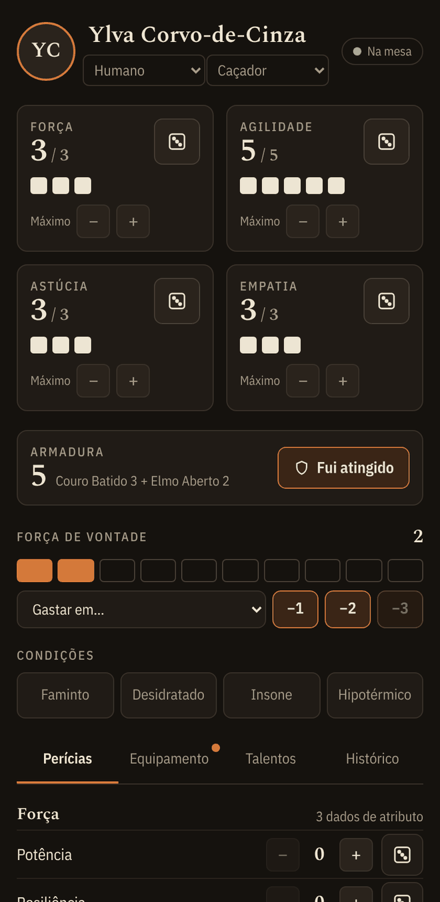

No topo ficam o nome, a ascendência e a profissão. Ao escolher a ascendência, o talento dela entra sozinho na ficha. Ao escolher a profissão, entram os Dados de Recurso iniciais dela. O selo **Na mesa** indica que a ficha está ligada ao TaleSpire.

**Atributos.** O número grande é o valor atual e o pequeno é o máximo. Cada quadradinho é um ponto. Clique em um quadradinho para marcar dano ou para recuperar. Use os botões − e + de "Máximo" para acertar o valor de criação. O ícone de dado rola o atributo puro.

**Armadura.** Mostra a soma da armadura e do elmo vestidos. O botão **Fui atingido** é explicado [mais abaixo](#ataque-armadura-e-dano).

**Força de Vontade.** Os quadradinhos laranja são seus pontos. Para gastar, escolha em "Gastar em…" o talento ou a magia e clique em −1, −2 ou −3. O gasto aparece no chat da mesa.

**Condições.** Clique para ligar ou desligar. Veja [Condições](#condições).

Embaixo ficam as abas **Perícias**, **Equipamento**, **Talentos** e **Histórico**. Uma bolinha vermelha na aba avisa que há algo para olhar, por exemplo sobrecarga.

 

### Perícias

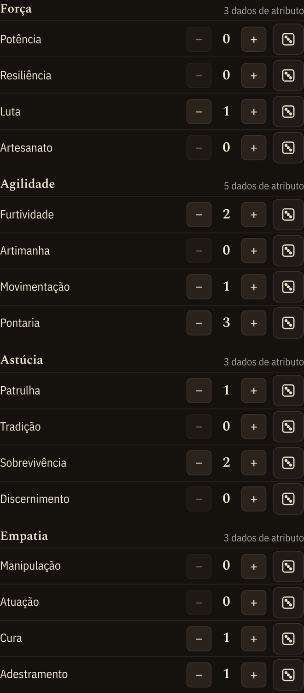

As 16 perícias ficam agrupadas pelo atributo, que mostra quantos dados ele rola agora. Use − e + para o nível da perícia. O ícone de dado abre a rolagem.

 

## Rolando dados

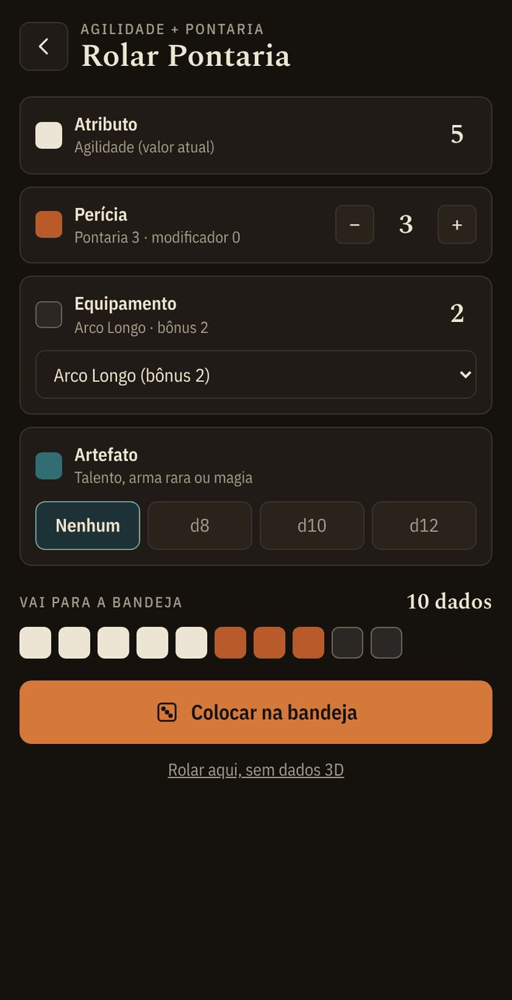

Ao clicar no dado de uma perícia, abre a tela de montar a rolagem. Cada linha pode ser ligada ou desligada:

- **Atributo**: já vem com o valor atual (com o dano descontado).
- **Perícia**: o nível, com o **modificador** do Mestre. Um modificador negativo tira dados de perícia e, abaixo de zero, vira dados negativos.
- **Equipamento**: escolha a arma ou ferramenta. O bônus dela entra como dados pretos.
- **Artefato**: d8, d10 ou d12, para talentos, armas raras ou magia.

A faixa "Vai para a bandeja" mostra os dados com as cores de cada tipo. Clique em **Colocar na bandeja**.

 

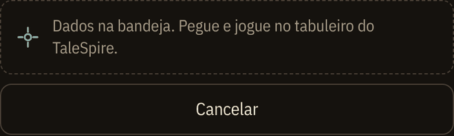

Agora pegue os dados na bandeja do TaleSpire e jogue no tabuleiro como sempre. A ficha espera o resultado. **Rolar aqui, sem dados 3D** serve para quando a bandeja estiver com problema.

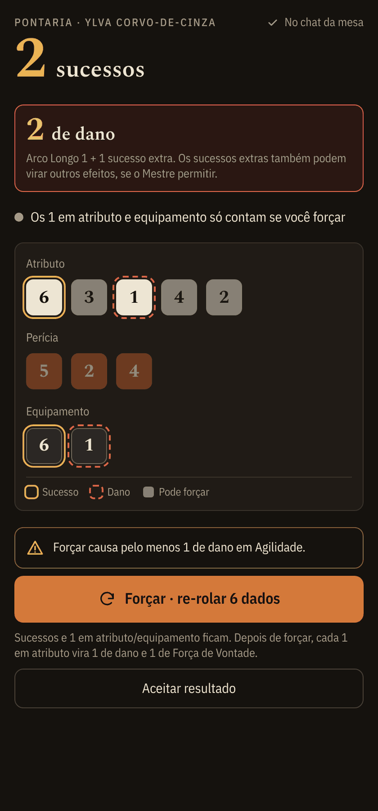

**O resultado** aparece na ficha e vai para o chat da mesa:

- O número grande é o total de sucessos.
- Contorno amarelo é um **sucesso** (6).
- Contorno tracejado vermelho é **dano**: um 1 em atributo ou equipamento. Esse dano só conta se você forçar.
- Os dados cinzas são os que podem voltar para a bandeja se você forçar.

Em ataques com Luta ou Pontaria, a caixa vermelha mostra o **dano do golpe**: o dano da arma mais 1 por sucesso além do primeiro.

 

## Forçar e Orgulho

Antes de forçar, a ficha avisa o que pode acontecer. Por exemplo: "Forçar causa pelo menos 1 de dano em Agilidade", ou "pode deixar Astúcia Acabada".

Clique em **Forçar**. A ficha coloca na bandeja **só** os dados que podem ser re-rolados. Jogue de novo.

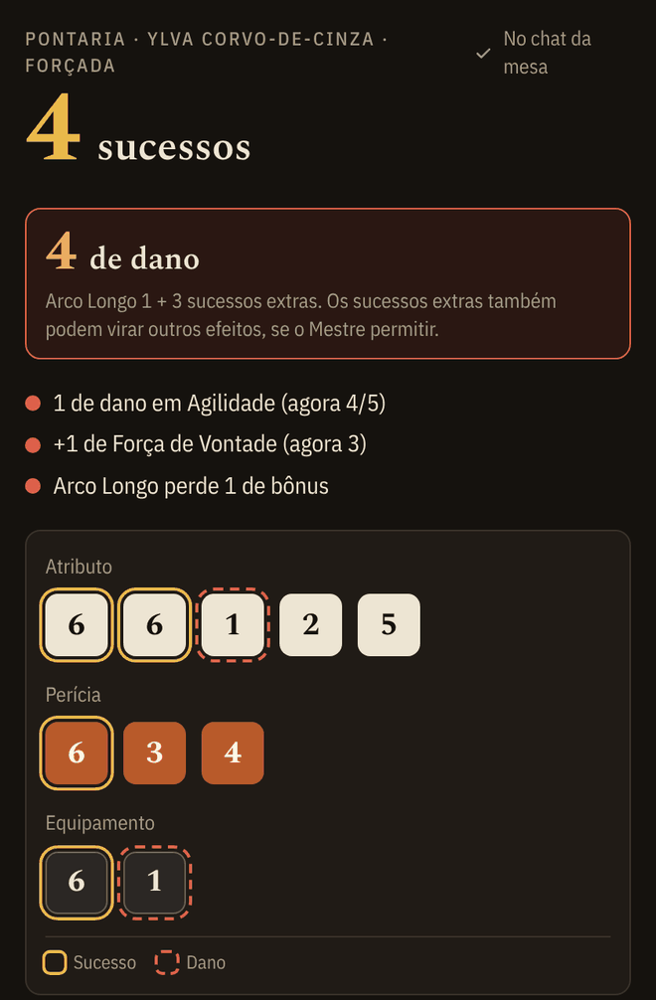

Depois de forçar, a ficha faz as contas sozinha:

- cada 1 em atributo vira 1 de dano no atributo e 1 de Força de Vontade;
- cada 1 em equipamento tira 1 do bônus do item.

A lista colorida mostra tudo o que mudou.

 

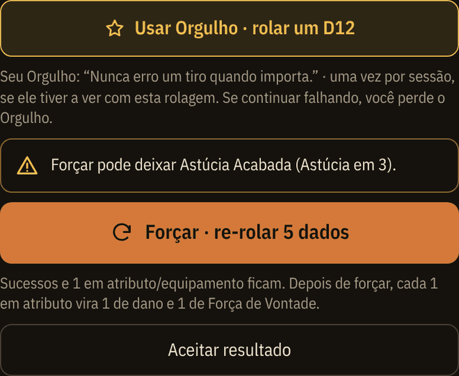

**Orgulho.** Quando um teste de perícia falha, aparece **Usar Orgulho**, que rola o D12 extra. O botão só aparece se você preencheu o Orgulho no Histórico e ainda não o usou na sessão. Se mesmo assim a rolagem falhar, a ficha marca o Orgulho como perdido. O Mestre libera o Orgulho de novo no fim da sessão.

Quando estiver satisfeito, clique em **Aceitar resultado**.

 

## Ataque, armadura e dano

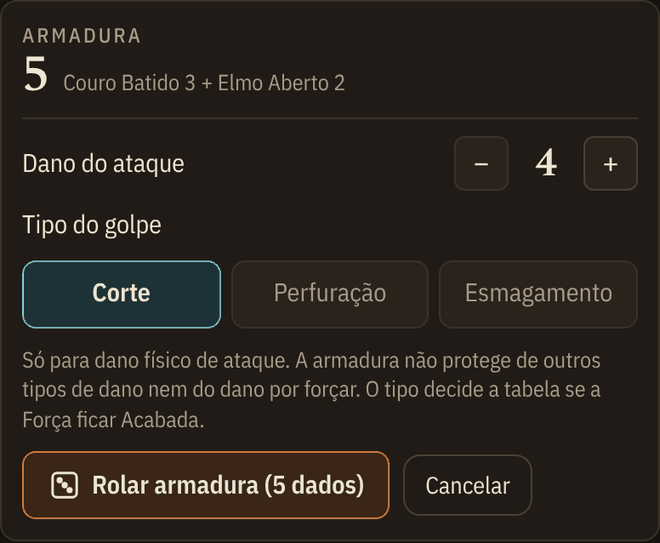

Quando um ataque acertar seu personagem, clique em **Fui atingido**, logo abaixo da armadura:

1. Coloque o **dano do ataque**.
2. Escolha o **tipo do golpe**: Corte, Perfuração ou Esmagamento. Ele define a tabela de ferimento se a Força ficar Acabada.
3. Clique em **Rolar armadura** e jogue os dados da bandeja.

 

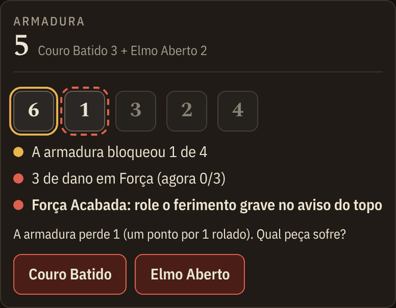

A ficha resolve o resto:

- cada 6 bloqueia 1 de dano;
- o resto do dano sai da Força;
- se algum dano passou, cada 1 rolado desgasta a armadura. Você escolhe se quem sofre é a armadura ou o elmo.

A armadura só protege de dano físico de ataque. Dano por forçar, frio ou fome você marca direto nos quadradinhos.

 

## Acabado e Ferimentos Graves

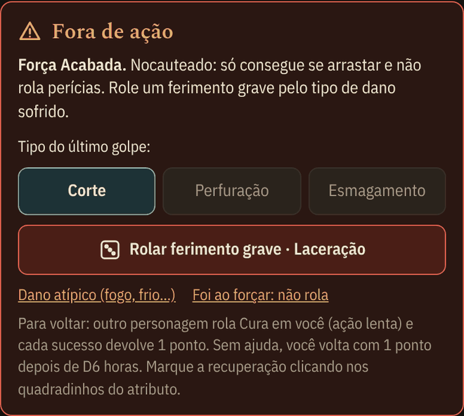

Quando um atributo chega a zero, aparece um aviso vermelho no topo da ficha, e o chat da mesa avisa também. O aviso diz o que acontece com o personagem e como ele volta.

Se a **Força** ou a **Astúcia** ficar Acabada por dano, a ficha pede para rolar um **Ferimento Grave**:

- **Força**: a tabela segue o tipo do último golpe (laceração, perfuração ou trauma). Já vem marcado o tipo que você escolheu no "Fui atingido".
- **Astúcia**: a tabela é a de horror.
- **Dano atípico (fogo, frio…)** tem uma opção própria.
- **Foi ao forçar**: não rola ferimento, como manda o livro.

 

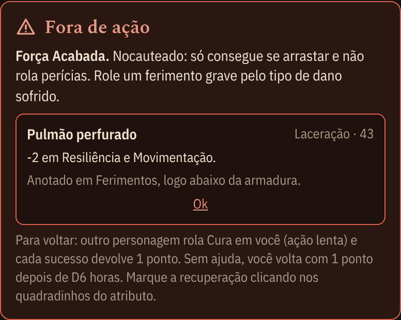

A ficha rola o D66 na bandeja, aplica a regra do elmo e mostra o ferimento, que fica anotado na ficha.

 

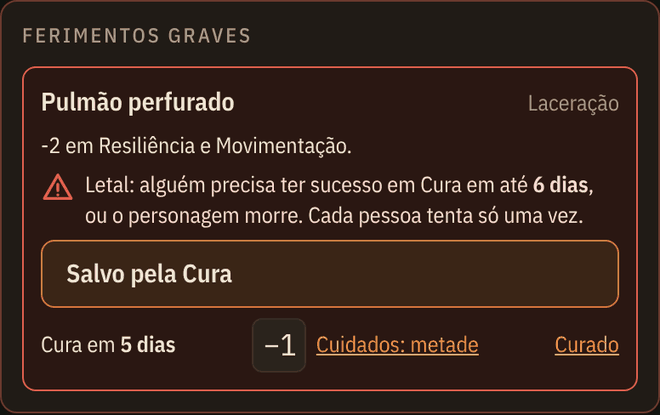

Os ferimentos ficam logo abaixo da armadura.

**Ferimento letal.** O prazo aparece em destaque. Quando alguém tiver sucesso na Cura, clique em **Salvo pela Cura**.

**Dias de cura.** Use **−1** a cada dia que passar. **Cuidados: metade** corta pela metade o tempo que falta. **Curado** remove o ferimento.

 

## Condições

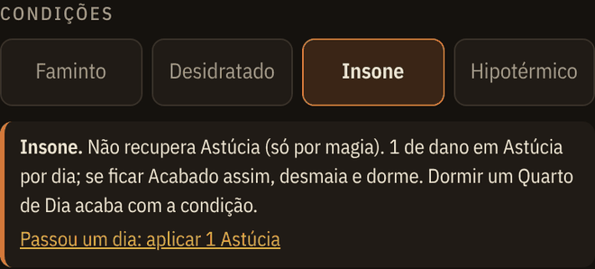

Clique em uma condição para ativá-la. Ela fica destacada e mostra o que causa.

O link de baixo aplica o dano periódico, por exemplo "Passou um dia: aplicar 1 Astúcia". A ficha também avisa se você tentar recuperar um atributo que a condição bloqueia.

 

## Equipamento, carga e moedas

Na aba **Equipamento**:

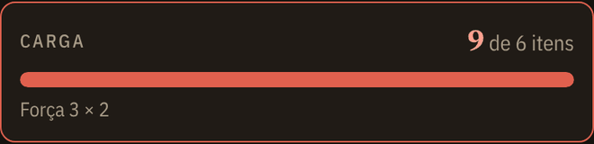

**Carga.** É calculada sozinha: Força máxima × 2, mais o talento Empacotador. Cada item pesa o que o livro diz (pequeno, leve, normal, pesado ou nada). A barra fica vermelha na sobrecarga, e a ficha explica o que isso causa.

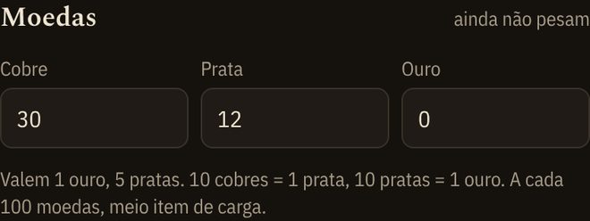

**Moedas.** Cobre, prata e ouro, com o valor total. Cada 100 moedas pesam meio item.

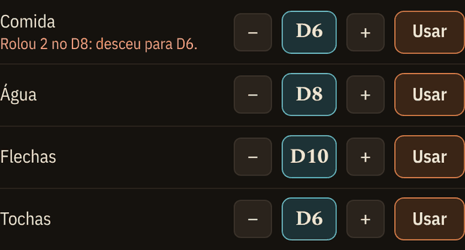

**Itens.** Escolha do catálogo do livro. O bônus, o peso, o dano e o tipo de golpe já vêm preenchidos.

- Armaduras e elmos têm a opção "vestido".
- Item com bônus 0 aparece como quebrado.
- Item danificado pode ser reparado com um clique.

 

## Consumíveis

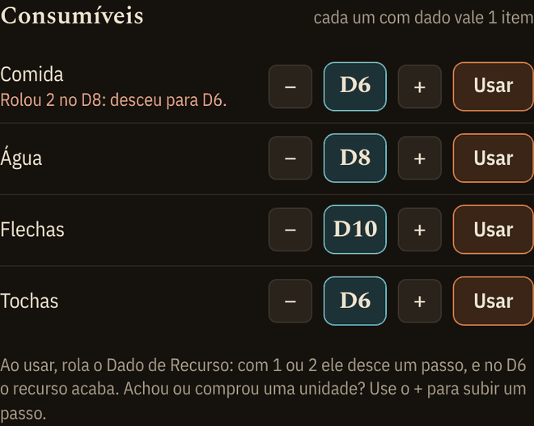

Comida, água, flechas e tochas são **Dados de Recurso**, de D6 a D12.

Clique em **Usar** para rolar o dado na bandeja:

- com 1 ou 2, ele desce um passo;
- com 1 ou 2 no D6, o recurso acaba.

O resultado vai para o chat. Achou ou comprou uma unidade? Use o **+** para subir um passo.

 

## Talentos

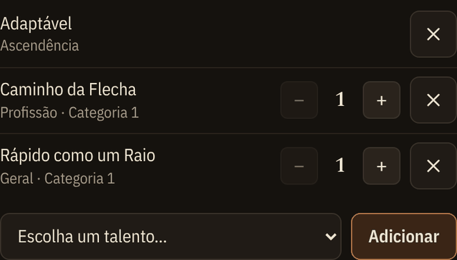

Na aba **Talentos**, escolha da lista (de ascendência, de profissão e gerais) e clique em **Adicionar**. Use − e + para a categoria (1 a 3). O × remove o talento.

O talento da ascendência entra sozinho. Rápido como um Raio e Empacotador já mudam a iniciativa e a carga.

 

## Reputação, XP e Evoluir

No topo da aba **Histórico**:

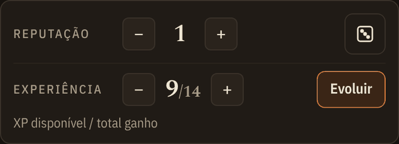

- **Reputação** de 0 a 10. O ícone de dado rola para ver se alguém reconhece o personagem.
- **Experiência**: o número grande é o XP disponível e o pequeno é o total já ganho. Quem dá XP normalmente é o Mestre, pelo painel dele.

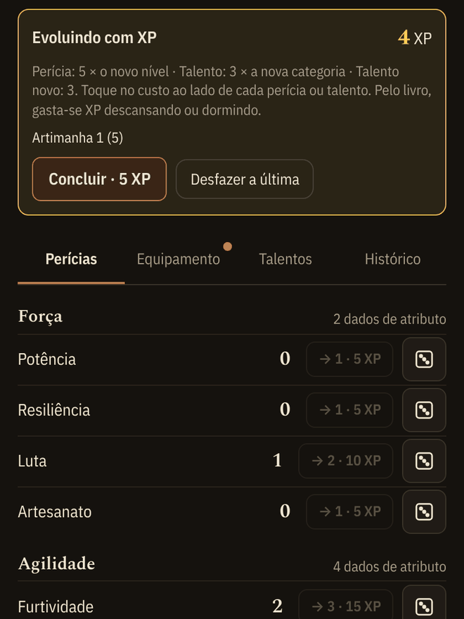

**Evoluir** abre o modo de gastar XP. Cada perícia e talento mostra o próximo nível e o custo do livro:

- perícia custa 5 × o novo nível;
- talento custa 3 × a nova categoria;
- talento novo custa 3.

Toque no custo para comprar. **Desfazer a última** volta atrás, e **Concluir** fecha e avisa no chat.

Pelo livro, gasta-se XP descansando ou dormindo, e atributos não evoluem com XP.

 

## Cópia de segurança

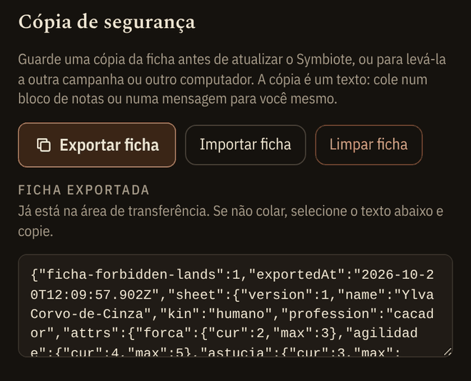

No fim da aba Histórico:

- **Exportar ficha** copia a ficha inteira como texto. Cole num bloco de notas ou mande para você mesmo.
- **Importar ficha** traz a cópia de volta.
- **Limpar ficha** recomeça do zero. Ela pede confirmação antes.

**Faça uma cópia antes de atualizar o Symbiote.** Também serve para levar a ficha para outra campanha ou outro computador.

 

---

# Para o Mestre

Quem tem permissão de Mestre no TaleSpire abre a ficha direto no **painel do Mestre**, com três abas: **Grupo**, **Iniciativa** e **Sessão**. O link **Abrir minha ficha de personagem** leva para uma ficha comum, se você também quiser usar uma.

Tudo o que aparece no painel vem das fichas **abertas** dos jogadores no mesmo tabuleiro.

## Grupo

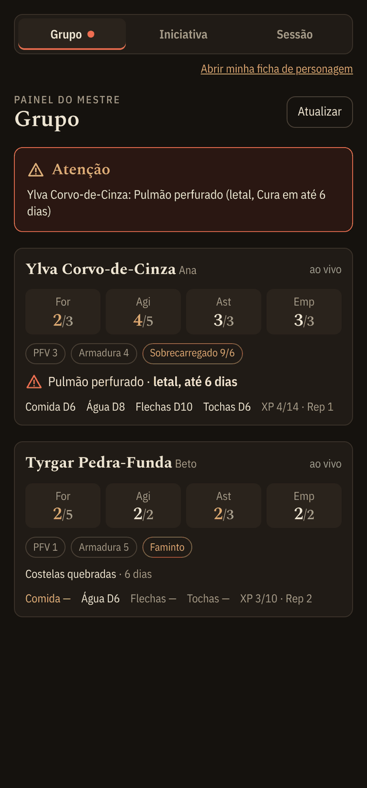

O Grupo mostra cada personagem ao vivo, com o nome do jogador ao lado. Cada cartão traz:

- **atributos**, em destaque quando estão com dano ou Acabados;
- Força de Vontade, armadura, sobrecarga e condições;
- **ferimentos**, com o prazo dos letais;
- consumíveis, XP e Reputação.

A caixa **Atenção** junta o que é urgente, como um ferimento letal com prazo correndo.

Quando um jogador fecha o Symbiote, o cartão dele aparece sem sinal. **Atualizar** pede de novo os dados de todo mundo.

 

## Iniciativa

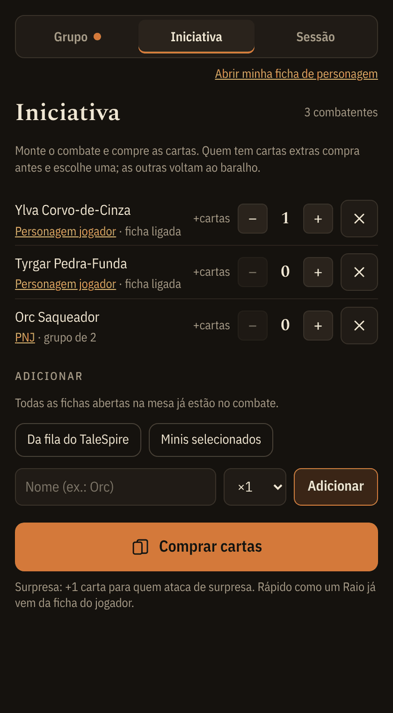

**Montar o combate.** As fichas abertas na mesa já entram sozinhas. Para adicionar mais gente:

- **Da fila do TaleSpire** traz quem está na fila de iniciativa do jogo;
- **Minis selecionados** traz as miniaturas selecionadas no tabuleiro;
- o campo de nome cria PNJs, inclusive em grupo (×2, ×3…), e um grupo usa uma carta só.

**+cartas** dá cartas extras, por exemplo para quem ataca de surpresa. Rápido como um Raio já vem da ficha do jogador.

Clique em **Comprar cartas**.

 

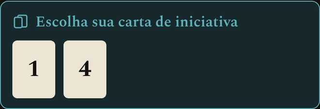

Quem tem cartas extras escolhe uma na própria ficha, e as outras voltam ao baralho. O Mestre também pode escolher pelo jogador no painel. Para os PNJs, quem escolhe é o Mestre.

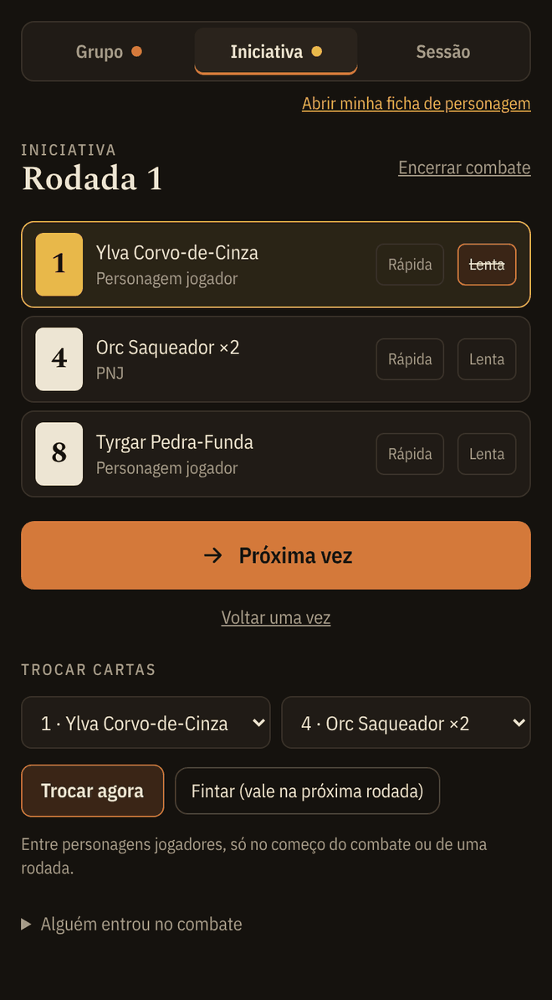

**Durante o combate:**

- A ordem segue as cartas. **Próxima vez** passa a vez e **Voltar uma vez** desfaz.
- **Rápida** e **Lenta** marcam as ações que cada um já usou na rodada.
- **Trocar cartas** troca a carta de dois combatentes. Entre personagens jogadores, só no começo do combate ou da rodada.
- **Fintar** marca uma troca que vale na próxima rodada.
- **Alguém entrou no combate** adiciona gente no meio da luta.
- **Encerrar combate** fecha tudo.

A ordem e a vez de cada um vão para o chat da mesa.

 

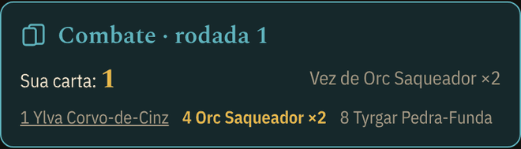

Na ficha de cada jogador aparece uma faixa com a carta dele, a ordem da rodada e de quem é a vez.

## Fim de sessão

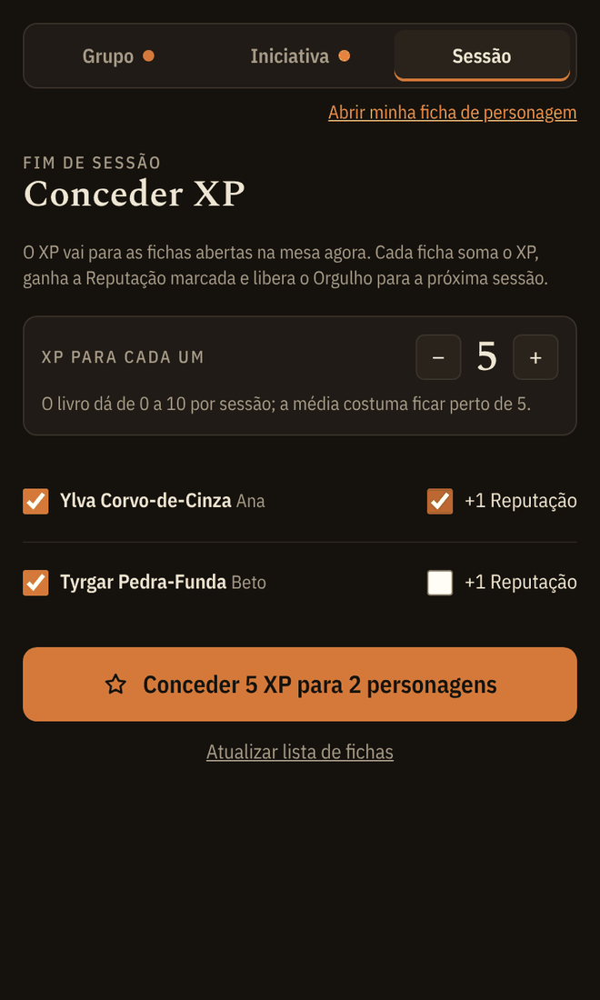

Na aba **Sessão**:

1. Escolha quanto **XP** dar para cada um. O livro fala de 0 a 10 por sessão, e o comum fica perto de 5.
2. Desmarque quem não deve receber.
3. Marque **+1 Reputação** para quem fez algo lendário.
4. Clique em **Conceder**.

As fichas abertas recebem na hora, somam o XP, ganham a Reputação marcada e liberam o Orgulho para a próxima sessão. Cada ficha confirma o recebimento.

Se alguém não aparece na lista, peça para o jogador abrir a ficha e clique em **Atualizar lista de fichas**.

 

---

## Dúvidas comuns

**Preciso deixar a ficha aberta?**
Não precisa deixá-la na tela, mas o Symbiote precisa estar ativo e você precisa estar no mesmo tabuleiro. Sem isso, o Mestre não vê você no Grupo e você não recebe XP nem a carta de iniciativa.

**Atualizar o Symbiote apaga a ficha?**
Não deveria, porque a ficha fica salva por campanha no TaleSpire. Mesmo assim, faça uma [cópia de segurança](#cópia-de-segurança) antes de atualizar.

**O TaleSpire mostra a soma dos dados. Está errado?**
A soma dos d6 não significa nada no Forbidden Lands, por isso a ficha esconde o resultado nativo. Vale o que aparece na ficha e no chat.

**Rolei e a ficha não reagiu.**
Confira se você jogou os dados que a ficha colocou na bandeja, e não dados de outra rolagem. Se a bandeja estiver com problema, cancele e use **Rolar aqui, sem dados 3D**.

**Mudei meu nome no TaleSpire.**
O painel do Mestre mostra o nome do personagem, com o nome do jogador ao lado. Mudar o nome de usuário não atrapalha nada.

**Achei um erro ou tenho uma ideia.**
Abra uma issue no [repositório do GitHub](https://github.com/erickhwk/forbiden-lands-symbiote/issues).

---

*Forbidden Lands é marca da Free League Publishing. Esta ficha é um projeto de fã, sem afiliação.*
